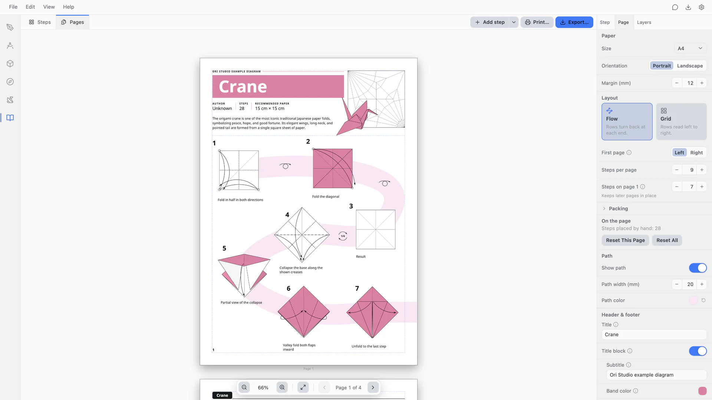
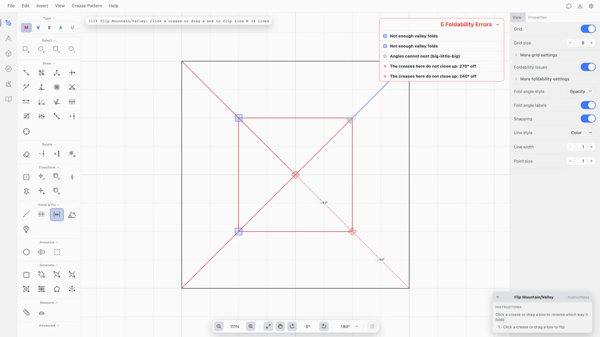
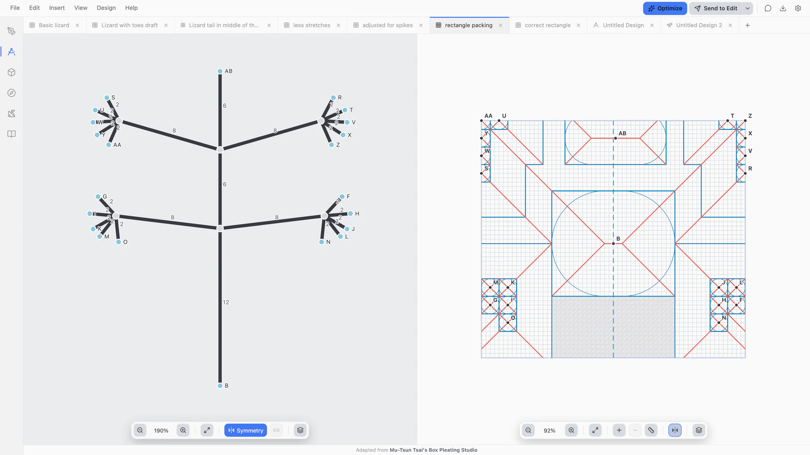
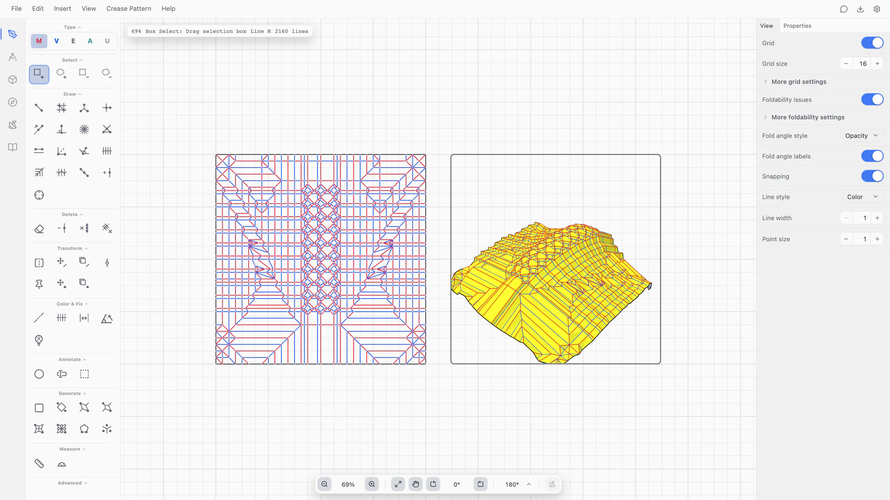
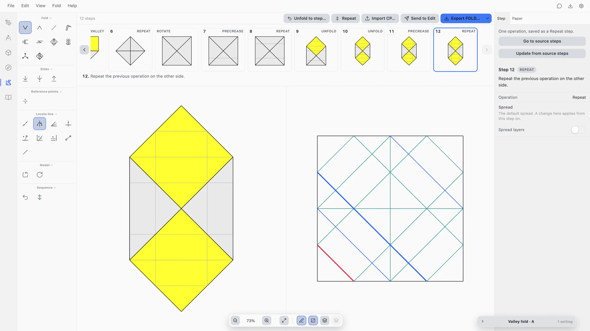
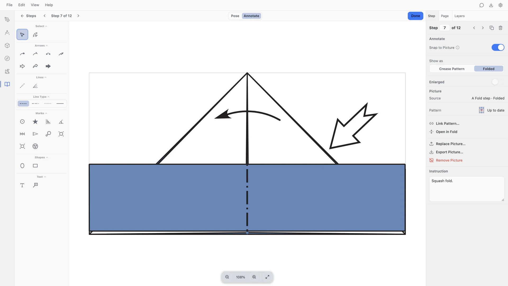
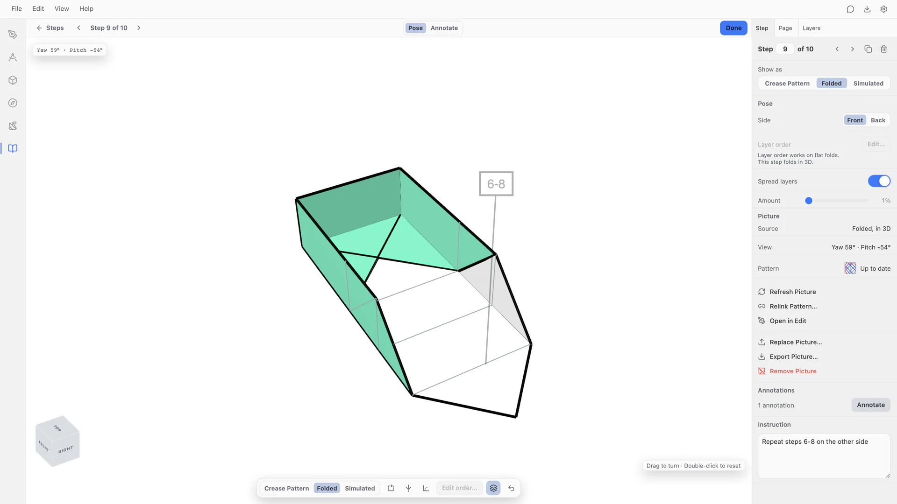

# Ori Studio

[](https://github.com/zacharyfmarion/ori-studio/actions/workflows/ci.yml)
[](https://oristudio.dev/)
[](https://github.com/zacharyfmarion/ori-studio/releases)

Ori Studio is a free, open-source workspace for origami design and analysis.
Design a base, draw and check its crease pattern, simulate it, fold it step by
step, and turn it into printed diagrams, all in one project. It runs in the
browser at [oristudio.dev](https://oristudio.dev/) or as a desktop app for macOS,
Windows and Linux.

<picture>
  <source media="(prefers-color-scheme: dark)" srcset="apps/web/public/landing/diagram-pages-dark-1920w.webp">
  
</picture>

Under a modern web and desktop interface sits a family of Rust and WebAssembly
engines, built largely from ports of tools the origami community already made:
[Oriedita](https://oriedita.github.io/) for crease-pattern editing,
[TreeMaker](https://langorigami.com/article/treemaker/) and
[Box Pleating Studio](https://bpstudio.abstreamace.com/) for design. Original
tools are built on top of them, and compatibility with the upstream tools and
their file formats stays a priority.

## What you can do

### Draw and edit crease patterns

The **Edit** workspace is the heart of the app: a crease-pattern editor ported
from Oriedita, with its construction and transform tools snapped to the grid and
to angles. Foldability is checked as you draw — Kawasaki and Maekawa where the
paper folds flat, and a 3D closure check for each vertex where it does not, so
non-flat creases can be drawn, simulated and solved too. Fold a sheet into a
flat folded figure beside its crease pattern and choose its layer order, put
reference photos and rich-text notes on the same canvas, and share a crease
pattern as a link that opens in any browser.

<picture>
  <source media="(prefers-color-scheme: dark)" srcset="apps/web/public/landing/edit-foldability-dark-1920w.webp">
  
</picture>

### Design a base

The **Design** workspace packs a model with whichever method suits it, with
several designs open side by side in tabs. Each one builds a crease pattern you
can send straight to Edit.

- **Box pleating** — a port of Box Pleating Studio: lay flaps out on a grid,
  with rivers, stretch devices and symmetry constraints.
- **Circle packing** — a port of TreeMaker 5: sketch a tree, set edge lengths
  and strain, and let the optimizer pack circles and rivers into a base.
- **ExplOri** — send your tree to Brandon Wong's searchable archive of 22.5°
  crease patterns and browse the closest matches.

<picture>
  <source media="(prefers-color-scheme: dark)" srcset="apps/web/public/landing/design-bp-dark-1920w.webp">
  
</picture>

### Simulate

Fold a crease pattern into 3D in a window beside the one you are drawing, or on
its own in the **Simulate** workspace. Pin faces and fold or pull the rest of
the paper around them, and export the fold as OBJ, ready for a texture in
Blender.

<picture>
  <source media="(prefers-color-scheme: dark)" srcset="apps/web/public/landing/simulate-dark-1920w.webp">
  
</picture>

### Fold step by step

The **Fold** workspace folds a sheet the way you would by hand: locate a line
with the Huzita–Justin axioms or an existing crease, then make a valley,
mountain or precrease fold, or a reverse, squash, petal, rabbit-ear, swivel,
crimp, pleat or sink fold, through the layers you pick. After every step you
see the flat folded form and its crease pattern. A sequence can start from a
crease pattern on a square, a rectangle or another convex sheet of up to eight
sides, repeat a run of steps on the other side, unfold back to an earlier step,
and send its steps to the Diagram as illustrated steps.

<picture>
  <source media="(prefers-color-scheme: dark)" srcset="apps/web/public/landing/fold-dark-1920w.webp">
  
</picture>

### Make diagrams

The **Diagram** workspace turns a model into printed folding instructions. Each
step's picture comes from the project — a sheet of the crease pattern, shown as
its crease pattern, folded (flat with its layers spread apart, or in 3D) or
simulated; a Fold step; a References card — or from a picture of your own, and
steps can be imported in batches from crease patterns, pictures or DEFOX
projects. Mark each step up with the standard symbols, lay the steps out on A4,
A5, B5 or Letter pages with a title block, and export a PDF or a ZIP of the step
pictures. An empty diagram offers an example crane to start from.

<p>
<picture>
  <source media="(prefers-color-scheme: dark)" srcset="apps/web/public/landing/diagram-annotate-dark-1920w.webp">
  
</picture>
<picture>
  <source media="(prefers-color-scheme: dark)" srcset="apps/web/public/landing/diagram-pose-dark-1920w.webp">
  
</picture>
</p>

### Find references

The **References** workspace answers two questions about the crease pattern you
have open: how to crease the whole pattern, as an ordered sequence of folds, and
how to locate one vertex or crease, with ranked folding sequences and a diagram
for each step. See [Finding references](docs/references-workspace.md).

### Detect a crease pattern from an image (beta)

**Detect CP from Image** (File menu): a photo or render of a square crease
pattern is cropped, run through a detection model, and solved into an exact,
editable crease pattern. The model downloads once (45 MB) and is kept on the
device; Settings ▸ Models shows what is installed.

### Open and save the formats you already use

Ori Studio opens and saves Oriedita (`.ori`, `.orh`, `.cp`), Box Pleating
Studio (`.bps`), TreeMaker (`.tmd5`, `.tmd4`) and FOLD files, and exports SVG
and PNG. Its own `.osf` project keeps everything those formats have no room for
— reference images, designs, fold sequences and diagrams — and you can always
export the crease pattern to a format that simply leaves them out.

## Download

Use the hosted app at [oristudio.dev](https://oristudio.dev/), or install the
desktop app from [GitHub Releases](https://github.com/zacharyfmarion/ori-studio/releases):
DMGs for Apple Silicon and Intel Macs, a Windows installer, and an AppImage and
a `.deb` for Linux.

## Applications

- `apps/web`: the shared React and Vite frontend used by the browser app and the
  Tauri shell.
- `apps/tauri`: the Tauri v2 desktop wrapper for native menus, dialogs, window
  metadata, and packaging.
- `apps/cp-detect-architecture-inspector`: a local debug UI for inspecting the
  crease-pattern detection and compiler pipeline stage by stage.

## Exposed Packages and Crates

### TreeMaker engine crates

Built from this workspace and used by the app. **Not currently published to
crates.io** — see [RELEASE.md](RELEASE.md#crates). Use them by path or git
dependency.

- `treemaker-core`: the native Rust engine API for TreeMaker model files,
  optimization, feasibility checks, crease-pattern generation, FOLD conversion,
  and simulation preparation.
- `treemaker-cli`: the `treemaker` command-line tool for inspecting, checking,
  optimizing, and exporting models.
- `treemaker-wasm`: `wasm-bindgen` bindings that expose the engine to browser
  and Node workflows.
- `treemaker-fold`: generic FOLD data structures and geometry helpers for
  origami applications.
- `treemaker-flatfold`: flat-foldability and layer-order solving for FOLD
  crease patterns.

The main TreeMaker engine entry point is `treemaker_core::Tree`.

### Ori Studio workspace crates

These crates power the Edit, box-pleating, Fold, and detection workflows and
live in the workspace alongside the TreeMaker engine.

- `oristudio-cp`: the Oriedita-compatible crease-pattern editing kernel.
- `oristudio-cp-wasm`: `wasm-bindgen` bindings for the crease-pattern kernel.
- `oristudio-cp-compiler`: the constraint-aware crease-pattern compiler core.
- `oristudio-bp`: the Box Pleating Studio-compatible headless kernel.
- `oristudio-bp-wasm`: `wasm-bindgen` bindings for the box-pleating kernel.
- `oristudio-cp-detect`: browser crease-pattern detection core types and oracle
  fixture plumbing.
- `oristudio-cp-detect-wasm`: `wasm-bindgen` bindings for browser crease-pattern
  detection.
- `oristudio-cp-eval`: crease-pattern evaluation metrics for detection and
  compiler benchmarks.
- `oristudio-cp-detect-inspector`: a local Rust API server backing the detection
  inspector app.
- `oristudio-fold`: the Fold workspace engine: flat folded states, the plain
  fold and compound folds.
- `oristudio-fold-wasm`: `wasm-bindgen` bindings for the Fold engine.
- `oristudio-layer-order`: layer order for flat folded states: pairwise order,
  cell overlay, constraints and a checker.
- `oristudio-geometry`: shared origami geometry: tolerance, lines, frames,
  Huzita–Justin constructions and convex-polygon primitives.

### npm workspace packages

- `@treemaker/web`: the private workspace package for the shared Ori Studio web
  app.
- `@treemaker/tauri`: the private workspace package for the desktop shell.
- `@treemaker/origami-simulator`: the private workspace package that adapts
  Origami Simulator-style folding utilities for FOLD inputs.
- `@treemaker/cp-detect-architecture-inspector`: the private workspace package
  for the crease-pattern detection inspector.

## Getting Started

Install dependencies:

```sh
npm ci
```

Run the web app:

```sh
npm run dev:web
```

Run the desktop app:

```sh
npm run dev:desktop
```

Use the Rust API:

```sh
cargo add treemaker-core
```

Install the command-line tool:

```sh
cargo install treemaker-cli
```

Use the WebAssembly bindings:

```toml
treemaker-wasm = "0.1"
```

## Development

Useful local checks:

```sh
cargo fmt --check
cargo clippy --workspace --all-targets -- -D warnings
cargo test --workspace
npm run lint:web
npm run typecheck:web
npm run test:web
wasm-pack build crates/treemaker-wasm --target bundler
wasm-pack test --node crates/treemaker-wasm
```

Roadmaps live in [`WEB_ROADMAP.md`](WEB_ROADMAP.md) and
[`PRODUCT_ROADMAP.md`](PRODUCT_ROADMAP.md). Release steps live in
[`RELEASE.md`](RELEASE.md). Porting notes live in [`PORTING.md`](PORTING.md).

## Acknowledgements

Ori Studio builds directly on origami tools created by the community:

- [Oriedita](https://github.com/oriedita/oriedita) — the crease-pattern editor is
  a Rust and WebAssembly port of the Oriedita editor (itself a fork of Orihime),
  including its foldability diagnostics, repairs, and file formats.
- [Mu-Tsun Tsai and Box Pleating Studio](https://github.com/bp-studio/box-pleating-studio)
  — the box-pleated authoring method is a Rust and WebAssembly port of Box
  Pleating Studio.
- [Amanda Ghassaei and Origami Simulator](https://github.com/amandaghassaei/OrigamiSimulator)
  — the Simulate workspace folds bases into an interactive 3D model using a
  TypeScript port of Origami Simulator.
- [Brandon Wong and ExplOri 22.5](https://225.designorigami.net/) — the Search
  22.5° design method sends your tree to ExplOri, a searchable archive of 22.5°
  crease patterns, and shows the closest matches it returns.
- [Jason S. Ku and Flat-Folder](https://github.com/origamimagiro/flat-folder)
  — the Fold workspace searches for a layer order with `treemaker-flatfold`, a
  Rust port of Flat-Folder's solver.
- [Kei Morisue and DEFOX](https://kei-morisue.github.io/step-folder/)
  — the Diagram workspace’s affine layer spreading is based on Morisue’s
  affine distortion method in DEFOX.
- [Robert J. Lang and TreeMaker 5.0.1](https://langorigami.com/article/treemaker/)
  — the original model code and behavior are the canonical reference for the
  Rust, WebAssembly, and desktop port.

## License

This project is `GPL-2.0-or-later` because it includes a direct Rust port of
TreeMaker's GPL model code, and because it bundles a second GPL work:
[ReferenceFinder](https://github.com/MuTsunTsai/reference-finder) — Robert J.
Lang's C++ as extended by Mu-Tsun Tsai and Omri Shavit — compiled to
WebAssembly from vendored source rather than ported. See
[`LICENSING.md`](LICENSING.md) for the full licensing guide, including the GPL
version question for that second work, optimizer backend notes, and the
dependency inventory.
